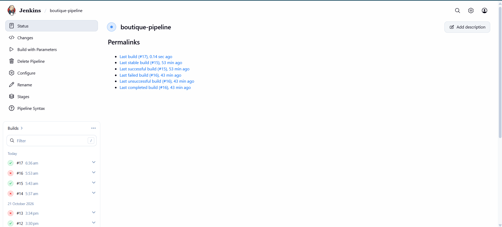
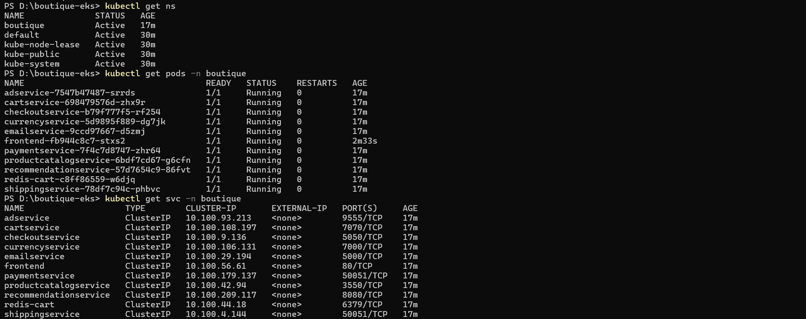
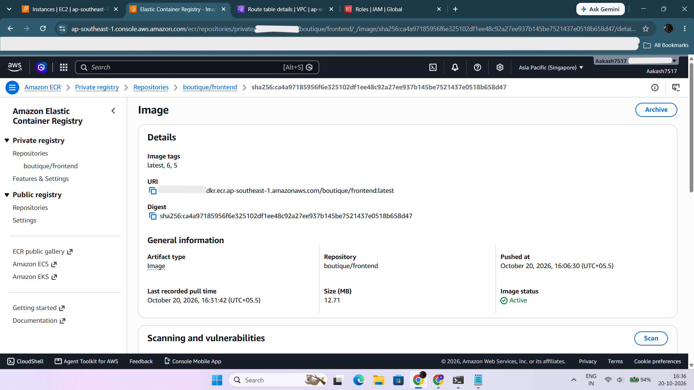
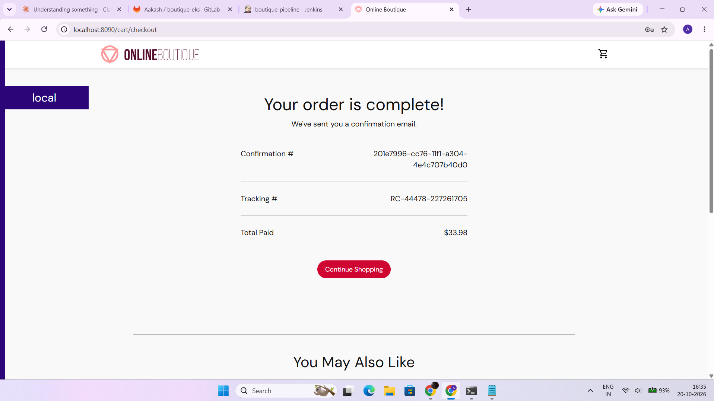
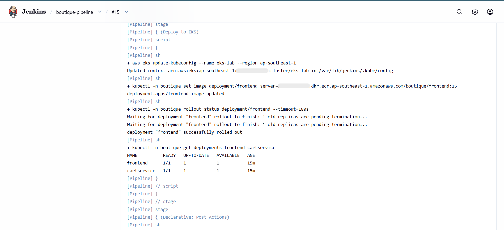
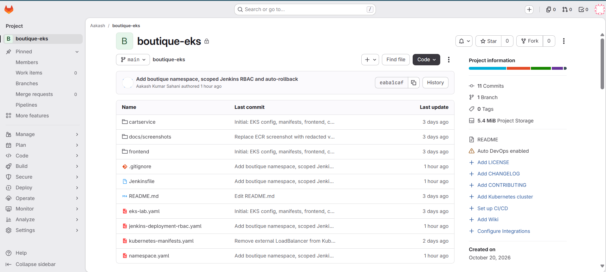
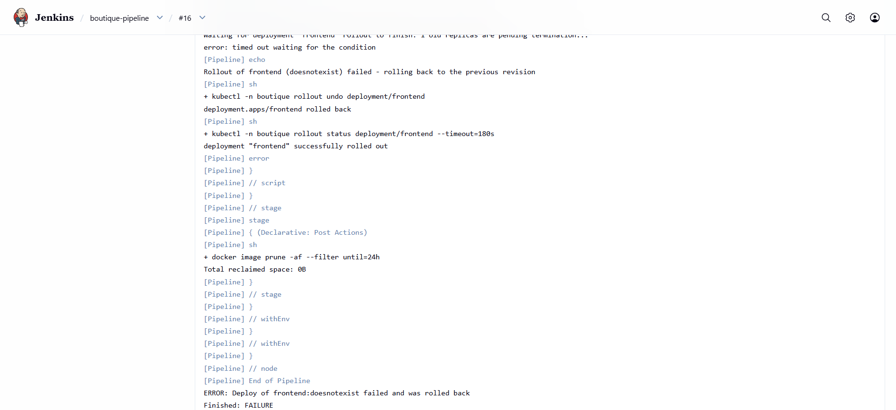
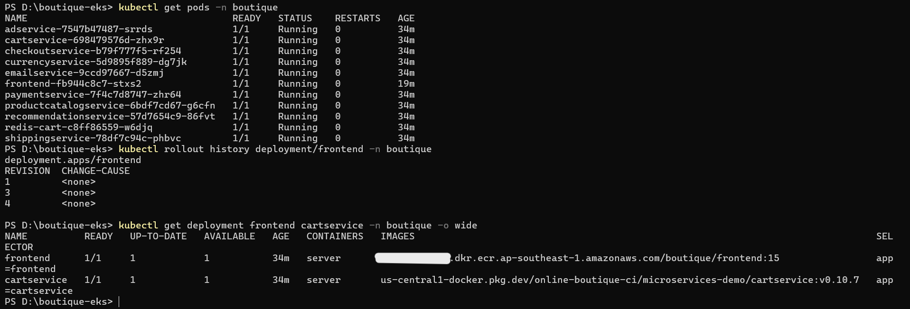

# Online Boutique on AWS EKS with a Self-Hosted CI/CD Pipeline

A hands-on cloud/DevOps project: a self-hosted **GitLab -> Jenkins -> Amazon ECR -> Amazon EKS** pipeline that builds and deploys the Google *Online Boutique* microservices demo, with a least-privilege deploy role and automatic rollback when a rollout fails.

## Architecture

```
Developer --push--> GitLab (EC2, private subnet)
                        |
                        v
                  Jenkins (EC2, private subnet)
                  |- docker build
                  |- push image --> Amazon ECR
                  |- kubectl set image --> Amazon EKS (eks-lab, namespace: boutique)
                  |- kubectl rollout status
                  `- kubectl rollout undo (if the rollout fails)
                                              `-- 11 microservices + Redis
```

- **Access:** bastion host + SSH tunnels (no public access to GitLab or Jenkins).
- **Jenkins -> AWS:** EC2 instance role (`jenkins-ec2-role`), no stored AWS keys.
- **Jenkins -> EKS:** EKS access entry plus a namespace-scoped Kubernetes `Role` (`jenkins-deployment-rbac.yaml`). Jenkins can only read, list, watch and patch the `frontend` and `cartservice` deployments in the `boutique` namespace, and read ReplicaSets (needed for rollback). It cannot create namespaces or touch other workloads.
- **Cluster:** created from a single config file (`eks-lab.yaml`) with `eksctl`, one `m7i-flex.large` node.
- **Exposure:** all Services are `ClusterIP`. There is no public load balancer; the shop is reached with `kubectl port-forward`.
- **Hardening in the manifests:** readiness and liveness probes and resource limits on the workloads.

## Tech stack

AWS (EKS, ECR, EC2, VPC, NAT Gateway, IAM, CloudFormation), Kubernetes (RBAC, namespaces, probes), Docker, Jenkins (declarative pipeline), GitLab, eksctl, kubectl, Linux.

## Repository layout

| Path | Purpose |
|---|---|
| `Jenkinsfile` | Pipeline: ECR login, build and push, optional deploy to EKS with auto-rollback |
| `eks-lab.yaml` | `eksctl` cluster definition (infrastructure as code) |
| `namespace.yaml` | Creates the `boutique` namespace |
| `jenkins-deployment-rbac.yaml` | Least-privilege Role and RoleBinding for Jenkins |
| `kubernetes-manifests.yaml` | Online Boutique manifests (ClusterIP services, probes, limits) |
| `frontend/`, `cartservice/` | Application source built by the pipeline |
| `docs/screenshots/` | Proof of the working pipeline |

## Pipeline

The Jenkins job takes three parameters: `SERVICE` (`frontend`, `cartservice` or `both`), `DEPLOY` (true/false) and an optional `IMAGE_TAG`.

1. **Checkout** from GitLab
2. **ECR Login** using the instance role
3. **Build and Push** the image, tagged with the build number and `latest`
4. **Deploy to EKS** (only when `DEPLOY` is true):
   - `kubectl -n boutique set image` with the new tag (or `IMAGE_TAG` if given)
   - `kubectl rollout status` with a 180 second timeout
   - if the rollout does not finish, `kubectl rollout undo`, wait for the old version to be healthy again, then fail the build

## Auto-rollback demo

To prove the rollback path, I deployed a tag that does not exist (`IMAGE_TAG=doesnotexist`):

1. Jenkins set the frontend image to the missing tag.
2. The new pod could not pull its image, so the rollout timed out after 180 seconds.
3. The pipeline ran `rollout undo`, the previous revision became healthy again, and the build finished as FAILURE with the message that the deploy was rolled back.
4. Throughout, the old pod kept serving traffic, so there was no downtime. The deployment history shows the failed revision and the rollback to the working image.

## Screenshots

**Jenkins build history**: green deploy, then the intentional rollback demo


**Namespace, pods and ClusterIP services**


**Image pushed to and pulled from ECR**


**Order completed in the shop** (via port-forward)


**Jenkins deploy stage** (`set image` and `rollout status` in the `boutique` namespace)


**GitLab repository**


**Rollback demo**: failed rollout, `rollout undo`, build marked failed


**Rollback verified**: pods healthy, revision history, running image is the previous good tag


## Running it

After the cluster exists, one-time setup is done by an admin. Jenkins is deliberately not allowed to do this.

```
eksctl create cluster -f eks-lab.yaml
aws eks update-kubeconfig --name eks-lab --region ap-southeast-1

# let the Jenkins instance role authenticate to the cluster
aws eks create-access-entry --cluster-name eks-lab --region ap-southeast-1 \
  --principal-arn arn:aws:iam::<AWS_ACCOUNT_ID>:role/jenkins-ec2-role

kubectl apply -f namespace.yaml
kubectl apply -f jenkins-deployment-rbac.yaml
kubectl apply -n boutique -f kubernetes-manifests.yaml
kubectl scale deployment loadgenerator -n boutique --replicas=0
```

Then run the Jenkins job with `DEPLOY=true`. To open the shop: `kubectl port-forward -n boutique svc/frontend 8090:80` and visit `http://localhost:8090`.

Note: the RoleBinding subject must match the Jenkins instance's assumed-role identity, so update it if the Jenkins instance is replaced.

## Problems I hit and how I fixed them

| Problem | Cause | Fix |
|---|---|---|
| EKS node group stuck in `DELETING` | Auto Scaling Group kept trying to launch a 2nd node and failed (`VcpuLimitExceeded`, 8 vCPU account limit) | Scaled the ASG to 0, then deleted the cluster and VPC in dependency order |
| `cartservice` stuck `Pending` | 2 vCPU node out of CPU requests | Scaled the load generator to 0 (now a manual step after applying the manifests, because Jenkins is scoped to `frontend` and `cartservice` only) |
| Jenkins had no internet, and ECR login timed out | Private route table had a blackhole `0.0.0.0/0` route after the NAT Gateway was deleted to save cost | Created a new NAT Gateway and pointed the route at it |
| `eksctl create cluster` failed with `AlreadyExistsException` | The cluster had been deleted outside CloudFormation, leaving the `eksctl-eks-lab-*` stacks behind | Deleted the stale stacks, then recreated the cluster |
| Stale stacks could not be deleted | CloudFormation termination protection was enabled on both stacks | Disabled termination protection, then deleted the nodegroup stack and the cluster stack in that order |
| Cluster stack stuck deleting its VPC | A security group created by EKS itself (not by CloudFormation) was still attached | Confirmed no ENIs, load balancers or gateways remained, deleted that security group, and the stack finished |
| Jenkins builds stuck "waiting for executor" | Node marked offline: stale low-disk reading after the EBS volume was resized | Grew the volume, restarted Jenkins |
| Jenkins UI unreachable through the tunnel | Port 8080 not reachable from the bastion | Tunnelled over SSH (port 22) via ProxyJump |
| `git push` over SSH refused | The SSH tunnel to the git server was not running | Re-opened the tunnel (or pushed over HTTP through the GitLab tunnel) |
| Jenkinsfile not found | Notepad saved it as `Jenkinsfile.txt` | Renamed the file |

## Cost control

The EKS control plane, node and NAT Gateway are billed hourly, so the cluster is created for each session and deleted afterwards with `eksctl delete cluster --name eks-lab --region ap-southeast-1`. Always delete through eksctl rather than the console, otherwise CloudFormation stacks are left behind. The NAT Gateway and Elastic IP for the Jenkins VPC are separate and are deleted and released at the end of each session. Images stay in ECR, and the whole setup is recreated from the config in about 20 minutes.

## What is automated and what is not

**Automated:** image build, ECR push, deploy to EKS, rollout health check, automatic rollback on failure, least-privilege access for Jenkins.

**Not automated yet:**
- Builds are started manually from Jenkins; there is no GitLab webhook trigger yet.
- Only `frontend` and `cartservice` are built by the pipeline; the other services use the stock images.
- There is no monitoring stack (Prometheus/Grafana) on this cluster.

## Next steps

- GitLab webhook to trigger builds on push
- Build all services in the pipeline, not just two
- Image scanning, and Ingress with a load balancer
- Monitoring with Prometheus and Grafana
- Rebuild the cluster with Terraform
